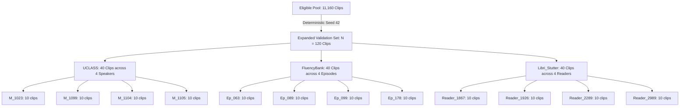

# SpeechAI — Ablation 7: Expanded Validation Plan

**Project:** `E:\SpeechPrj`  
**Run Directory:** `evaluation_results/experimental/ablations/ablation7_validation_expansion/`  
**Execution Timestamp:** `2026-10-20T15:59:00+05:30`  
**Auditor:** Antigravity Autonomous Agent  
**Target Reference for Evaluation:** Frozen Ablation 3 Reference (`evaluation_results/experimental/ablations/stutter_fn_recovery/run_20261020_144131/`)  
**Holdout Isolation:** **100% FROZEN & UNACCESSED**  
**Execution Status:** **PLANNING ONLY (Zero inference executed)**  
**Final Feasibility Verdict:** **READY FOR EXPANDED VALIDATION**

---

## 1. Objective & Scope

This document specifies the exact, reproducible execution protocol for evaluating the **frozen, unchanged Ablation 3 reference** on an expanded, speaker-disjoint validation set ($N = 120$ clips). 

### Methodological Principles:
1. **Zero Detector Modifications:** The evaluation engine, thresholds, and detector weights remain identical to Ablation 3.
2. **Strict Holdout Protection:** The 750-clip holdout dataset remains completely uninspected and unaccessed.
3. **Partition Mutual Exclusivity:** Zero overlap with the 30-clip development set, the 750-clip holdout set, or the 60-clip generalization validation set.
4. **Pre-Registered Evaluation Protocol:** All metrics, denominators, zero-division conventions, and stratification rules are locked prior to running inference.
5. **Execution Gate:** No feature extraction or inference will run until this plan and the candidate split are reviewed.

---

## 2. Split Selection & Deterministic Sampling Protocol

### 2.1 Recommended Split Architecture: Option A ($N = 120$ Clips)
The primary recommended split doubles the statistical power of the 60-clip benchmark while maintaining balanced representation across all three clinical/audio domains:

### 2.2 Stratification Targets ($N = 120$):
- **UCLASS (40 clips):** 21 Stutter (52.5%), 8 Filler (20.0%), 11 Clean (27.5%).
- **FluencyBank (40 clips):** 18 Stutter (45.0%), 13 Filler (32.5%), 9 Clean (22.5%).
- **Libri_Stutter (40 clips):** 28 Stutter (70.0%), 0 Filler (0.0%), 12 Clean (30.0%).
- **Aggregate Distribution ($N = 120$):**
  - **Stutter:** **67 clips** (55.8%)
  - **Filler:** **21 clips** (17.5%)
  - **Clean:** **32 clips** (26.7%)
  - **Total:** **120 clips** (100.0%)

### 2.3 Deterministic Selection Rules:
- **RNG Seed:** Fixed to `seed = 42` using Python `random.seed(42)`.
- **Pre-Filtering:** Every clip must exist on disk, exceed 44 bytes, and have complete annotations.
- **Verification Gate:** Verify against `main_benchmark_manifest.json`, `run_manifest.json` (val60), and `per_clip_comparison.json` (dev30) to mathematically ensure zero clip or speaker intersection.

---

## 3. Preflight Feature Caching Protocol

To ensure reproducible, deterministic, and efficient evaluation:
1. **Isolated Cache Path:**
   - Features will be cached in: `evaluation_results/experimental/expanded_validation/run_expanded_120/feature_cache_expanded.json`
   - Keeps feature storage completely decoupled from the existing 60-clip cache.
2. **Cached Attributes per Clip:**
   - Raw Whisper Large-v3 timestamped transcript and token segments.
   - LIBROSA acoustic features: vocal threshold, noise floor, mean energy, pitch stability (`pitch_std_st`), spectral flux (`mean_flux`).
   - Prolongation candidates ($\ge 0.25$s).
   - Silent block candidates (pause duration, burst ratio).
   - Syllable contextual timing and word boundary mappings.
3. **Cryptographic Integrity:**
   - Once generated, compute and lock the SHA-256 hash of `feature_cache_expanded.json`.

---

## 4. Evaluator Configuration & Baseline Immutability

The expanded validation benchmark will evaluate the **identical frozen Ablation 3 configuration**:
- **Evaluator:** `CanonicalEvaluator` (`backend/experimental/canonical_evaluator.py`).
- **N-gram Repetition Detector:**
  - `enable_ngram_repetition = True`
  - `ngram_sizes = (2, 3)`
  - `ngram_repetition_confidence = 0.85`
- **Interrupted Repetition Detector:**
  - `enable_interrupted_repetition = True`
  - `min_interrupted_similarity = 0.85`
  - `interrupted_confidence = 0.85`
- **Acoustic Gating Safety Floors:**
  - `min_prolongation_duration_sec = 0.50`
  - `severe_prolongation_duration_sec = 0.60`
  - `min_silent_block_duration_sec = 0.40`
  - `plosive_burst_ratio_threshold = 1.50`
- **Context Engines:** Syllable context enabled (`enabled=True`), lexical-syntactic context enabled (`enabled=True`).

---

## 5. Formal Metric Suite & Reporting Standards

### 5.1 Primary Multi-Class Metrics (3 Classes: Clean, Stutter, Filler)
- **3-Class Confusion Matrix:** Rows = True Label, Columns = Predicted Label (Class order: Clean, Stutter, Filler).
- **3-Class Accuracy:** $\text{Correct} / N_{\text{total}}$ ($N = 120$).
- **Per-Class Precision, Recall, F1, Specificity:**
  $$\text{Precision}_c = \frac{TP_c}{TP_c + FP_c}, \quad \text{Recall}_c = \frac{TP_c}{TP_c + FN_c}, \quad \text{F1}_c = \frac{2 \cdot P_c \cdot R_c}{P_c + R_c}, \quad \text{Specificity}_c = \frac{TN_c}{TN_c + FP_c}$$
- **Macro F1:** Unweighted arithmetic mean across Clean, Stutter, and Filler.
- **Support-Weighted F1:** F1 scores weighted by class support.

### 5.2 Primary Binary Stutter Metrics (Clinical Target)
- **Positive Class:** `Stutter`.
- **Negative Class:** `Clean` or `Filler`.
- **Contingency Table:** Explicitly output TP, FP, FN, TN, and Total ($TP + FP + FN + TN = 120$).
- **Binary Precision, Recall, F1, Specificity, Accuracy.**

### 5.3 Per-Corpus Metrics & Matrix Sum Reconciliation
- Output independent confusion matrices and metric suites for:
  1. `UCLASS / SEP-28k` (Clinical recordings)
  2. `FluencyBank` (Spontaneous podcasts)
  3. `Libri_Stutter` (Controlled read speech)
- **Reconciliation Audit:** Verify that the sum of the three per-corpus confusion matrices exactly equals the aggregate 120-clip confusion matrix cell-by-cell.

### 5.4 Confidence Intervals & Statistical Rigor
- Compute **95% Bootstrap Confidence Intervals** (1,000 resamples with replacement) for 3-class accuracy, stutter precision, stutter recall, and stutter F1.

### 5.5 Operational & Latency Telemetry
- **Processing Success Rate (%):** Expected 100%.
- **ASR Timeout Rate (%):** Flag any clip exceeding safety CPU limits (25.0s).
- **Inference Latency Distribution:** Mean, median, standard deviation, and p95 latency (seconds per clip).
- **Real-Time Factor (RTF):** Mean inference time divided by clip audio duration.

### 5.6 Speaker / Episode Stratified Diagnostics
- Report accuracy, stutter precision, and recall stratified across all 12 individual source entities (`M_1023`, `M_1099`, `M_1104`, `M_1105`, `Ep_063`, `Ep_089`, `Ep_099`, `Ep_178`, `Reader_1867`, `Reader_1926`, `Reader_2289`, `Reader_2989`) to detect any speaker-specific acoustic anomalies or out-of-distribution shifts.

---

## 6. Execution Stop Gate & Deliverables Protocol

In accordance with user instructions:
- **NO INFERENCE HAS BEEN RUN.**
- **NO DETECTOR CODE OR THRESHOLDS HAVE BEEN MODIFIED.**
- **THE 750-CLIP HOLDOUT REMAINS 100% UNTOUCHED.**
- Execution stops upon delivery of this inventory and plan.
- When authorized to execute, deliverables will be stored in:
  `evaluation_results/experimental/expanded_validation/run_<timestamp>/`
