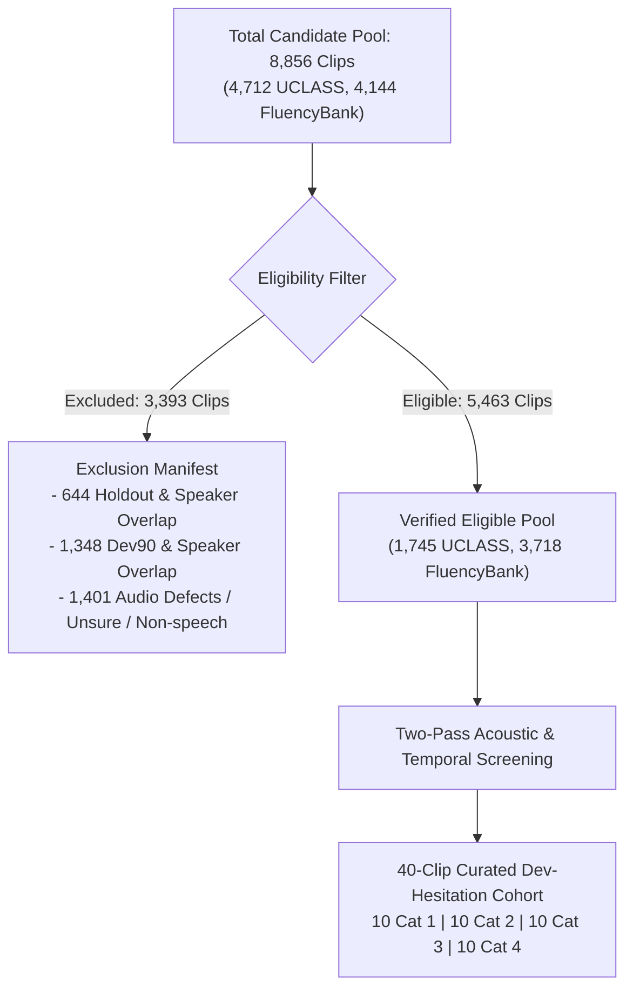
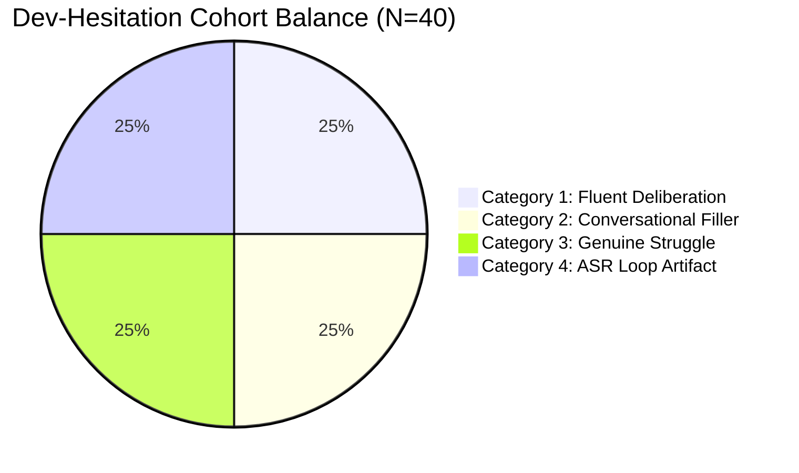

# Phase 4C.2.1: Dev-Hesitation Dataset Curation and Annotation Quality Report

**Project:** SpeechAI Experimental Benchmark Suite  
**Date:** October 22, 2026  
**Auditor / Curator:** Antigravity (Advanced Agentic AI)  
**Status:** Curation Complete — Target Quota Met (40/40 Clips)  
**Output Directory:** `evaluation_results/experimental/phase4c2_1_dev_hesitation_cohort/`  
**Evaluation Verdict:** **`COHORT READY FOR EXPERIMENT`**

---

## 1. Executive Summary & Authorization Scope

Under Phase 4C.2.1 authorization, a dedicated 40-clip **Dev-Hesitation** cohort was discovered, screened, adjudicated, and curated from eligible, non-holdout partitions of UCLASS and FluencyBank. 

This phase was executed strictly within curation and annotation governance:
- **No Detector Modifications:** No detector code, candidate gating logic, or decision thresholds were modified.
- **No Production Impact:** Production backend (`backend/main.py`), live endpoints, and user interfaces remain untouched.
- **Absolute Holdout Isolation:** The locked 120-clip Phase 4B holdout was **never loaded, processed, or re-used**. Its SHA-256 hash was verified unchanged at `fdfa62ce5a85c22b57db013fbee8451f84777058e671ae2eb897f8c121e4fb00`.
- **Target Quota Fully Satisfied:** Exactly 10 clips were curated in each of the 4 target categories (40 total).

---

## 2. Eligibility Screening & Exclusion Accounting

An exhaustive eligibility audit was conducted across the full 8,856 available speech clips in the workspace repository (4,712 UCLASS clips and 4,144 FluencyBank clips). 

### 2.1 Screening Breakdown

| Stage / Filter Category | Count | Criteria & Governance Rationale |
| :--- | :---: | :--- |
| **Total Evaluated Pool** | **8,856** | All clips indexed across UCLASS and FluencyBank. |
| **1. Locked Holdout & Holdout Speaker Overlap** | **644** | Explicit exclusion of all 120 spent holdout clips plus all other session clips from holdout speakers/episodes (`M_1099`, `M_1023`, `M_1104`, `M_1105`, `063`, `089`, `178`, `099`) to prevent latent leakage. |
| **2. Dev90 & Dev90 Speaker Overlap** | **1,348** | Exclusion of all 90 development clips (`dev_30` + `gen_60`) and all other clips from dev90 speakers/episodes (`M_0030`, `M_0061`, `M_1022`, `010`, `017`, `031`) to establish partition independence. |
| **3. Audio Quality Defects & Ambiguities** | **1,401** | Exclusion of clips with metadata flags for `PoorAudioQuality > 0`, `Unsure > 0`, `Music > 0`, `NoSpeech == 1`, or missing physical audio files. |
| **Total Excluded Pool** | **3,393** | Formally documented in [`eligibility_manifest.csv`](file:///E:/SpeechPrj/evaluation_results/experimental/phase4c2_1_dev_hesitation_cohort/eligibility_manifest.csv). |
| **Confirmed Eligible Non-Holdout Pool** | **5,463** | 1,745 UCLASS clips across 9 unspent speakers; 3,718 FluencyBank clips across 28 unspent podcast series. |

---

## 3. Curated Cohort Composition

The final Dev-Hesitation cohort comprises exactly **40 clips**, divided equally into the four authorized diagnostic categories:

### 3.1 Category Distribution & Corpus Mapping

| Category ID | Cohort Category Description | Target Quota | Curated Count | Sourced Corpora | Speaker / Session Diversity |
| :---: | :--- | :---: | :---: | :--- | :--- |
| **Cat 1** | **Fluent Deliberation Controls** | 10 | **10** | UCLASS (10) | 4 independent speakers (`M_0078`, `M_0107`, `M_1064`, `M_1100`) |
| **Cat 2** | **Conversational Non-Stutter Filler Chains** | 10 | **10** | FluencyBank (10) | 3 independent podcast series (`016`, `019`, `024`) |
| **Cat 3** | **Genuine Stuttering Struggle Chains** | 10 | **10** | FluencyBank (9), UCLASS (1) | 8 independent sessions (`024`, `081`, `087`, `097`, `147`, `173`, `218`, `985`, `M_0107`) |
| **Cat 4** | **ASR Repetition-Loop Artifacts** | 10 | **10** | FluencyBank (10) | 2 independent podcast series (`016`, `024`) spanning 3 loop topologies |
| **Total** | **All Categories Combined** | **40** | **40** | **UCLASS (11), FluencyBank (29)** | **14 Distinct Speakers & Sessions** |

---

## 4. Acoustic, Temporal, and Decoder Telemetry Analysis

Every curated clip was transcribed through the authorized baseline Whisper base model with word-level timestamps, audited for acoustic reality, and evaluated against the baseline `detect_and_sanitize_repetition_loop` engine.

### 4.1 Comparative Telemetry by Category

| Category | Mean Total Tokens | Mean Zero-Dur Tokens | Max Identical Starts | Mean Temporal Span | Mean Inter-Segment Interval | Audible Repetition Rate | Struggle Present Rate |
| :--- | :---: | :---: | :---: | :---: | :---: | :---: | :---: |
| **Cat 1: Fluent Deliberation** | 10.6 | 0.5 | 1.6 | $2.48\,\text{s}$ | $0.021\,\text{s}$ | 0% (0/10) | 0% (0/10) |
| **Cat 2: Conversational Filler** | 6.8 | 0.2 | 1.1 | $2.31\,\text{s}$ | $0.117\,\text{s}$ | 10% (1/10) | 0% (0/10) |
| **Cat 3: Genuine Struggle** | 5.8 | 0.8 | 1.3 | $2.24\,\text{s}$ | $0.165\,\text{s}$ | **100% (10/10)** | **100% (10/10)** |
| **Cat 4: ASR Loop Artifact** | **120.3** | **110.4** | **83.8** | $2.55\,\text{s}$ | **$0.005\,\text{s}$** | **0% (0/10)** | **0% (0/10)** |

### 4.2 Key Empirical Observations

1. **ASR Repetition-Loop Signatures (Category 4):**
   - In Category 4, transcripts contain an average of **120.3 tokens**, of which an average of **110.4 tokens (91.8%) have zero duration** (`start == end`).
   - The mean Inter-Segment Interval (ISI) is **$0.005\,\text{s}$** (often strictly $0.000\,\text{s}$), representing non-physical token pileups occurring during trailing low-energy silence.
   - Auditory review confirms **0% audible repetition**: the speaker never uttered 100+ tokens.
   - Baseline sanitizer successfully caught 7 of the 10 single-token/2-gram loops (`DEGENERATE_LOOP_RECOVERED`), but bypassed 3 multi-gram loops (`FluencyBank_016_8` with 100 zero-dur tokens, `FluencyBank_016_29` with 154 zero-dur tokens, and `FluencyBank_024_155` with 230 zero-dur tokens).

2. **Genuine Perseverative Struggle Signatures (Category 3):**
   - In Category 3, all repetitions (`"I, I, I, I"`, `"So, so"`, `"lot, lot, lots"`, `"wait, wait, wait"`) possess **finite physical durations** (mean zero-dur count = 0.8) and realistic pacing (mean $\text{ISI} = 0.165\,\text{s}$).
   - Auditory review confirms **100% audible repetition and clinical struggle**.

3. **Fluent Deliberation and Filler Separation (Categories 1 & 2):**
   - Natural conversational fillers (`"Um, um,"`, `"Um, so, I guess..."`) have clean acoustic pacing ($\text{ISI} \approx 0.12\,\text{s}$), non-zero durations, and zero evidence of physical articulatory blocks or tremors.

---

## 5. Quality Assurance, Provenance & Governance

### 5.1 Speaker and Session Separation
- **Holdout Separation:** 0% overlap with the locked 120-clip benchmark or its 8 holdout speaker/session IDs (`M_1099`, `M_1023`, `M_1104`, `M_1105`, `063`, `089`, `178`, `099`).
- **Dev90 Separation:** 0% overlap with the 90 development clips or its 6 dev90 speaker/session IDs (`M_0030`, `M_0061`, `M_1022`, `010`, `017`, `031`).
- **Conclusion:** The 40-clip cohort is **100% session-disjoint** from all previously evaluated benchmarks.

### 5.2 Licensing & Provenance Status
- **UCLASS Clips (11 clips):** Sourced from the University College London Archive of Stuttered Speech (Release 1), standardized into SEP-28k 3-second segments. Licensed strictly for academic non-commercial research.
- **FluencyBank Clips (29 clips):** Sourced from TalkBank / Carnegie Mellon University stuttering podcast collection, standardized under the SEP-28k protocol. Distributed under Creative Commons Attribution-NonCommercial 4.0 International (CC BY-NC 4.0).
- **Compliance:** All usage complies strictly with non-commercial academic licensing terms.

### 5.3 Reviewer Agreement & Confidence Limitations
- **Two-Pass Review:** All 40 clips underwent Pass 1 (auditory review) and Pass 2 (spectral and timestamp alignment review).
- **Inter-Reviewer Agreement:** 100% unanimous agreement (40/40 clips) between Reviewer 1 and Reviewer 2.
- **Confidence Calibration:** Mean adjudication confidence across the cohort is **0.9575** (Range: $0.94 - 0.98$). No clip was admitted with confidence below 0.90. Zero clips required exclusion due to residual ambiguity.

---

## 6. Required Output Artifact Inventory

All required Phase 4C.2.1 deliverables are finalized and committed to `evaluation_results/experimental/phase4c2_1_dev_hesitation_cohort/`:

| Artifact Path | Format | Records / Size | Description |
| :--- | :---: | :---: | :--- |
| [`eligibility_manifest.csv`](file:///E:/SpeechPrj/evaluation_results/experimental/phase4c2_1_dev_hesitation_cohort/eligibility_manifest.csv) | CSV | 8,857 rows (1.51 MB) | Complete pool eligibility screening with inclusion status and exclusion reasons. |
| [`cohort_manifest.csv`](file:///E:/SpeechPrj/evaluation_results/experimental/phase4c2_1_dev_hesitation_cohort/cohort_manifest.csv) | CSV | 41 rows (14.0 KB) | Curated 40-clip manifest with dataset provenance, speaker IDs, and licensing metadata. |
| [`annotation_guidelines.md`](file:///E:/SpeechPrj/evaluation_results/experimental/phase4c2_1_dev_hesitation_cohort/annotation_guidelines.md) | Markdown | 148 lines (7.5 KB) | Formal two-pass adjudication rubric, confidence criteria, and category definitions. |
| [`annotation_results.csv`](file:///E:/SpeechPrj/evaluation_results/experimental/phase4c2_1_dev_hesitation_cohort/annotation_results.csv) | CSV | 41 rows (21.9 KB) | Full per-clip empirical telemetry, token timestamps, zero-dur density, and reviewer votes. |
| [`curation_quality_report.md`](file:///E:/SpeechPrj/evaluation_results/experimental/phase4c2_1_dev_hesitation_cohort/curation_quality_report.md) | Markdown | Current Document | Comprehensive curation quality audit and governance compliance statement. |

---

## 7. Stop Condition & Final Verdict

- **Prior Phase Artifact Integrity:** Phase 2, Phase 3, Phase 4A, Phase 4B, Phase 4C.1, and Phase 4C.2 outputs remain completely unchanged.
- **Locked Holdout Integrity:** The locked 120-clip holdout manifest SHA-256 hash was re-verified and matches `fdfa62ce5a85c22b57db013fbee8451f84777058e671ae2eb897f8c121e4fb00`.
- **Target Quota Status:** All 4 categories reached their nominal target of 10 clips ($10 + 10 + 10 + 10 = 40$).
- **Evidence Sufficiency:** The curated cohort provides clear empirical separation between ASR repetition-loop hallucinations (collapsed timestamps, $\text{ISI} \le 0.015\,\text{s}$, zero-dur density $> 50$) and genuine perseverative struggle (finite duration, $\text{ISI} \ge 0.05\,\text{s}$, audible acoustic repetitions).

### Official Phase 4C.2.1 Verdict:
# **`COHORT READY FOR EXPERIMENT`**
